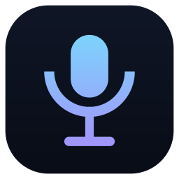

<div align="center">



# voiceverb

Live microphone reverb, EQ and voice effects for calls, with a system-tray desktop app and global hotkeys.

[](https://github.com/gabrielSantosLima/voiceverb/actions/workflows/ci.yml)
[](https://github.com/gabrielSantosLima/voiceverb/releases)
[](LICENSE)

</div>

voiceverb captures your microphone and processes your voice in real time with
the Web Audio API. Monitor through headphones or route the processed voice to a
virtual audio device for Discord, Zoom, Google Meet and Teams. Everything runs
locally: no accounts, telemetry or audio uploads.

## Key features

- Real-time convolution reverb, 3-band EQ, compressor, gate, pitch, robot,
  drive, backing harmonies and limiter.
- Virtual audio device routing for calls, plus headphone monitoring.
- Desktop app with system tray, global hotkeys and Windows autostart.
- Browser/PWA and native Windows/Linux builds.
- Local-only audio processing and offline service worker.

## Requirements

- Chrome or Edge 110+ for output routing (`setSinkId`).
- A secure context: HTTPS, localhost or the desktop `app://` protocol.
- Python 3 or Node.js to serve the static web app.
- A virtual audio driver (VB-CABLE, BlackHole, PipeWire/null sink) only for calls.
- Node.js 22.12+ for desktop development and packaging (Electron 45).
- Headphones are strongly recommended to avoid feedback.

## Getting started

Serve the static app:

```bash
python -m http.server 8123 --bind 127.0.0.1
# or
npx --yes serve -l 8123 .
```

Open <http://127.0.0.1:8123/> in Chrome or Edge, click **Ligar microfone** and
allow microphone access. For call routing, see [CALL-SETUP.md](CALL-SETUP.md).

Desktop development:

```bash
npm install
npm start
```

Build the installers:

```bash
npm run dist        # Windows: NSIS installer + portable
npm run dist:linux  # Linux: AppImage + tar.gz
```

## License

This project is licensed under the MIT License. See the [LICENSE](LICENSE) file
for details.
